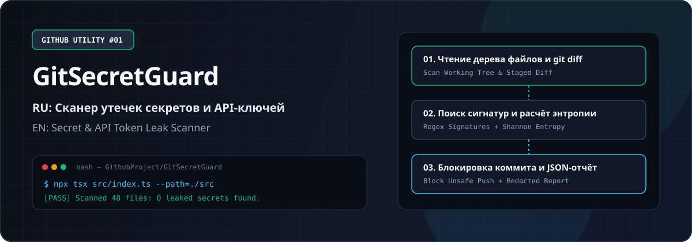
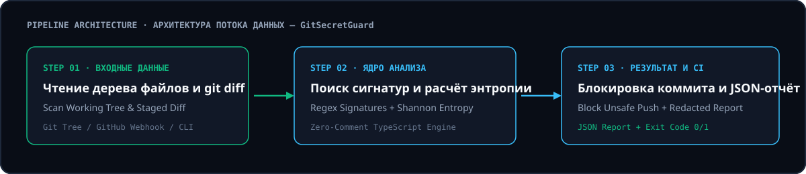

# 01. GitSecretGuard — Сканер утечек секретов, API-ключей и приватных токенов / Pre-Commit & CI Secret, API Key and Token Leak Scanner



**Язык документации / Documentation Language:** [🇷🇺 Русский](#-русская-документация) · [🇬🇧 English](#-english-documentation)

---

## 🇷🇺 Русская документация

### О программе
Мгновенно проверяет коммиты и файлы репозитория на наличие случайно оставленных ключей AWS, GitHub PAT, Stripe, приватных RSA-ключей и паролей до отправки в публичный доступ.

**Зачем нужна эта программа:** Предотвращает компрометацию облачной инфраструктуры и блокирует пуш с забытыми ключами в .env или исходниках.

### Ключевые возможности
- Детекция 15+ форматов токенов (GitHub PAT, AWS, Google Cloud, Slack, Stripe, Private Keys)
- Расчёт энтропии Шеннона для поиска нестандартных зашифрованных секретов
- Автоматическая маскировка найденных ключей в логах безопасности
- Ненулевой код возврата (exit code 1) для мгновенной остановки GitHub Actions

### Архитектура и схема работы



### Как это работает (пошагово)
1. Скачайте папку 01-GitSecretGuard и запустите npx tsx src/index.ts ./ в корне вашего репозитория.
2. Программа рекурсивно обойдёт исходные файлы (игнорируя node_modules и .git) и проверит каждую строку регулярными правилами и фильтром энтропии.
3. Если секреты не найдены, утилита вернёт статус CLEAN (код 0). При обнаружении утечки выведет файл, номер строки и замаскированный фрагмент.

### Быстрый старт (Установка и запуск)
```bash
cd GithubProject/01-GitSecretGuard
npm install
npx tsx src/index.ts --path=. --fail-on-leak
```

### Параметры командной строки (CLI)
| Флаг | Описание | По умолчанию |
| :--- | :--- | :--- |
| `--path` | Путь к папке репозитория для проверки | `.` |
| `--entropy` | Порог энтропии Шеннона для подозрительных строк | `4.3` |
| `--json` | Вывод отчёта в формате JSON для CI | `false` |

---

## 🇬🇧 English Documentation

### Overview
Scans staged files and repository trees for leaked AWS credentials, GitHub PAT tokens, Stripe keys, private RSA keys, and high-entropy secrets before they reach remote branches.

**Why you need it:** Prevents cloud infrastructure compromise by blocking pushes containing hardcoded credentials or .env secrets.

### Key Features
- Detects 15+ credential formats (GitHub PAT, AWS, Google Cloud, Slack, Stripe, Private Keys)
- Shannon entropy calculation for catching custom high-entropy tokens
- Automatic secret redaction in terminal and CI logs
- Non-zero exit code (exit 1) to halt GitHub Actions pipelines on leak detection

### How It Works (Step-by-Step)
1. Download 01-GitSecretGuard and run npx tsx src/index.ts ./ at the root of your repository.
2. The scanner recursively walks source files (skipping node_modules and .git) and evaluates lines against signature rules and Shannon entropy.
3. Returns status CLEAN (exit code 0) when safe, or prints the exact file, line number, and redacted token (exit code 1).

### Quick Start (Installation & Usage)
```bash
cd GithubProject/01-GitSecretGuard
npm install
npx tsx src/index.ts --path=. --fail-on-leak
```

### CLI Options
| Flag | Description | Default |
| :--- | :--- | :--- |
| `--path` | Target repository directory path to scan | `.` |
| `--entropy` | Shannon entropy threshold for token detection | `4.3` |
| `--json` | Emit structured JSON report for CI pipelines | `false` |

### GitHub Actions Integration (`.github/workflows/main.yml`)
```yaml
name: GitSecretGuard Security Scan
on:
  push:
    branches: [main, master]
  pull_request:
    branches: [main, master]
jobs:
  run-utility:
    runs-on: ubuntu-latest
    steps:
      - name: Checkout repository
        uses: actions/checkout@v4
      - name: Setup Node.js
        uses: actions/setup-node@v4
        with:
          node-version: 20
      - name: Execute GitSecretGuard Security Scan
        run: npx tsx src/index.ts .
```

---

### Стандарты кода / Code Standards
- **0 комментариев в коде / Zero Code Comments:** Весь исходный код (`src/index.ts`) написан в самодокументируемом стиле строго без комментариев (`//` или `/* */`). / All source code is strictly self-documenting with zero comments.